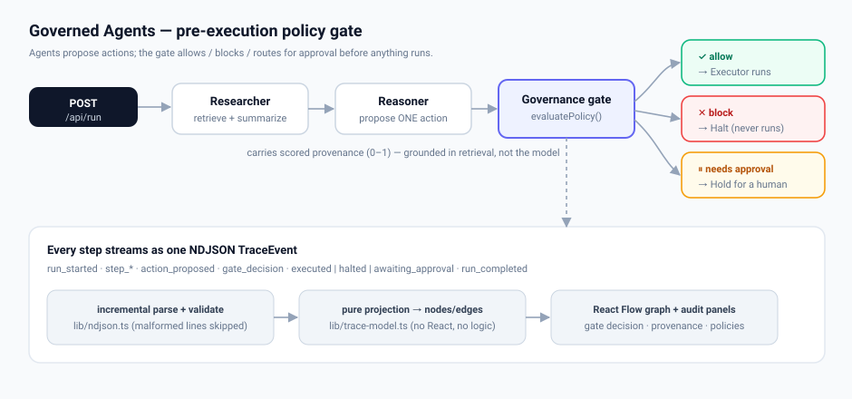

# Governed Agents

[](https://github.com/axiom-orion/governed-agents/actions/workflows/ci.yml)

**Agents that know what they're _not_ allowed to do.**

Give an AI agent real tools and it will take real, irreversible actions — send the
email, write the record, delete the row — sometimes on weak or unverified evidence.
**Governed Agents** puts an explicit **policy gate** in front of every action an
agent proposes: the gate **allows**, **blocks**, or **routes for human approval**
_before_ anything runs, with scored provenance and an auditable, streamed trace of
exactly what happened and why.

**▶ Run it locally — no API key needed:**

```bash
npm ci && npm run dev   # then open http://localhost:3000
```

Click **“Watch it block a risky action,”** then edit a policy threshold and re-run to
watch the same action flip from **blocked** to **allowed**. Without an
`ANTHROPIC_API_KEY`, a deterministic offline stub stands in for the models; with one,
the agents call a current Claude model server-side. There is no hosted demo at the
moment; the local run above is the full app.



---

## Why this exists (the thesis)

The interesting problem with agents isn't capability — it's **governance**. An agent
that can act needs a layer that decides, _per action_, whether it's allowed to. That
layer should be:

- **Pre-execution** — checked _before_ the side effect, not flagged after.
- **Explicit** — policy is named rules with thresholds, not vibes baked into a prompt.
- **Grounded** — decisions key off provenance that comes from retrieval, never
  fabricated by the model.
- **Auditable** — every step is an event on a trace you can inspect and replay.

The graph is the vehicle; **governance is the point.**

## See it in 30 seconds

| Try this | What it shows |
|---|---|
| **▶ Watch it block a risky action** | A guided walkthrough narrates, step by step, _why_ an outbound email is blocked: the only source scores 0.55, the rule requires ≥ 0.70, so the action halts before anything is sent. |
| **Edit the threshold → Re-run** | Lower `no-unverified-external-send` below 0.55 and the **same** action flips **BLOCK → ALLOW**. The flip is real: Sample recomputes the gate, Live re-runs the backend with your override. |
| **View raw trace** | The actual streamed `TraceEvent`s, in order, pretty-printed — proof it's a real NDJSON stream, not a canned animation. |
| **Scenario picker** | A spread of governance behaviors: confidence threshold, **PII leak**, and an **irreversible delete** that needs **human approval** (a third decision state). |

## What's verified

`npm test` runs six offline suites with no API key and no network. CI runs the same
six on every pull request:

| Suite | Checks | What it pins |
|---|---|---|
| Trace projection contract | 70 | the event stream → graph projection, the parser's handling of malformed lines, and the policy flip |
| Attested independence + Red Cell | 42 | consensus, distinct-voice counting, and the adversarial reviewer's independence |
| Policy edge cases | 131 | PII detection, score validation, unknown action kinds, approval tokens |
| Cosign intervention surface | 42 | approve/reject round trip, the audit chain, fail-closed expiry, drift events |
| Gate evaluation | 85 cases | the labelled results below still match what the gate does |
| Loop smoke test | 2 runs | an allowed task executes; a blocked task halts |

The gate is a pure function, so these are deterministic. Live-model behaviour (real
Claude, Gemini and Grok calls) is not covered by CI.

## How good is the gate? (measured)

The suites above pin behaviour the gate is known to have. The evaluation asks a harder
question: on actions labelled by what the policy is *meant* to do, how often is it right?
[`evals/gate-cases.ts`](evals/gate-cases.ts) holds 85 labelled actions, including
personal data written in non-standard ways and numbers that only look like personal data.

| measure | result |
|---|---|
| exact decision correct | 66 / 85 (0.776) |
| unsafe allows (should have been stopped, was allowed) | 17 / 62 (0.274) |
| false stops (should have been allowed, was stopped) | 2 / 23 (0.087) |
| `block` precision / recall | 0.950 / 0.704 |
| `needs_approval` precision / recall | 1.000 / 0.875 |

What that says:

- **The structural rules hold.** Provenance, unknown kinds, irreversible actions and
  standard-format personal data score 28 / 28.
- **Pattern-based PII detection is evadable.** Only 8 of 20 rewrites are caught: an SSN
  with dots or slashes, a card number broken across lines, and digits spelled out all get
  through. This is the measured version of the caveat in the code that production should
  put a real DLP service behind the rule.
- **Two gaps are not about PII.** Extra recipients in `cc` / `bcc` are not checked, and the
  gate trusts the declared action kind, so a `write_record` whose payload asks for a
  delete is allowed.

Every miss is listed by name in [`evals/gate-results.md`](evals/gate-results.md). The
labels are one author's judgement, not an external benchmark. CI fails if the gate's
behaviour drifts from the published results in either direction, so these numbers cannot
go stale silently: `npm run eval:gate` checks, `npm run eval:gate -- --write` regenerates.

## How it works

A run is a small server-side loop — **Researcher → Reasoner → governance gate →
execute / halt / hold** — that emits **one `TraceEvent` per line (NDJSON)**, flushed
as each step completes. The browser parses it incrementally, validates every line,
projects it to a node/edge graph, and renders. The gate
([`lib/governance.ts`](lib/governance.ts)) is a pure, synchronous function, so its
decisions are deterministic and testable without a browser.

**Full data flow, transport, and the event schema:**
[`docs/ARCHITECTURE.md`](docs/ARCHITECTURE.md).

```ts
// the wire format (lib/trace-events.ts)
type TraceEvent =
  | { type: "run_started";       runId: string; task: string; at: string }
  | { type: "step_started";      stepId: string; role: AgentRole; at: string }
  | { type: "step_completed";    stepId: string; role: AgentRole; summary: string; provenance: Provenance[]; at: string }
  | { type: "action_proposed";   stepId: string; action: ProposedAction; at: string }
  | { type: "gate_decision";     stepId: string; decision: PolicyDecision; at: string }
  | { type: "executed";          stepId: string; result: string; at: string }   // allow
  | { type: "halted";            stepId: string; reason: string; at: string }   // block
  | { type: "awaiting_approval"; stepId: string; reason: string; at: string }   // needs-approval
  | { type: "run_completed";     runId: string; at: string }
  | { type: "error";             message: string; at: string };
```

## The policy

`evaluatePolicy(action, rules)` resolves a three-tier outcome — a hard **block**
beats a **review** request beats **allow**:

| Rule | Applies to | Decides |
|---|---|---|
| `known-action-kind` | every action | **block** if the kind is not one the policy was written for (`send_email`, `write_record`, destructive kinds) — unknown kinds fail closed |
| `require-provenance` | every action | **block** if no supporting source carries a valid score (a finite number in [0, 1]) |
| `no-unverified-external-send` | outbound `send_email` | **block** unless `payload.to` is exactly one address (one `@`, no list separators or line breaks), and unless some source with a valid score is ≥ the confidence threshold (default **0.70**, editable in the UI) |
| `no-pii-in-external-output` | outbound `send_email` | **block** if any string, number or key in the payload contains personal data: US SSN, card (Luhn-checked outside 15–16 digits), US/UK/international phone, IBAN (checksum-verified), UK sort code (labelled, or beside an 8-digit account), labelled account number. Invisible characters, Unicode dashes and non-ASCII digits are folded first; a payload too large, too deep or unreadable to scan in full fails closed |
| `destructive-action-needs-approval` | `delete_record` / destructive kinds | **needs-approval** unless the payload's `approvalToken` matches a retrieved approval record (`ticket:<token>`) scoring ≥ **0.70** (`APPROVAL_MIN_SCORE`, independent of the editable send threshold) — the proposer cannot approve itself |
| `require-model-consensus` | multi-model (triad) runs | **needs-approval** when model agreement falls below the threshold (default unanimous) |
| `require-distinct-voices` | multi-model (triad) runs | **needs-approval** when the agreeing votes resolve to fewer than 2 distinct attested model instances — corroboration counts voices, not echoes |
| `red-cell-independence` | red-cell-reviewed actions | **needs-approval** when the reviewing instance is (or cannot be proven not to be) the proposing instance — oversight is theater otherwise |
| `red-cell-objection` | red-cell-reviewed actions | **needs-approval** when the adversarial reviewer objects, with the critique attached |

The thresholds are genuinely editable: they flow to the **Live** backend in the
request body, and the **Sample** replay **recomputes** the gate
([`lib/policy-replay.ts`](lib/policy-replay.ts)) rather than replaying a baked-in
decision — so the flip is real on both paths.

### Model consensus and adversarial review

Two optional layers sit on top of the hard rules, and both run in the Sample scenarios
with zero keys:

- **Consensus.** Claude, Gemini and Grok can each propose the action. A split, or a
  "unanimous" vote that resolves to one model instance echoed, goes to a human.
- **Red Cell.** An adversarial reviewer argues against consequential actions. Its verdict
  only counts if it runs on a model instance provably distinct from the proposer.

How voices are attested, the fallback chain, and the limits of that attestation:
[`docs/CONSENSUS.md`](docs/CONSENSUS.md).

## The intervention console

The gate and the Red Cell are automated control. The **intervention console**
(`/console` when running locally) is the human half: the page where an operator watches
a fleet of agents and steps in.

- **Cosign queue.** A held action appears with its full context. The operator approves or
  rejects, and the decision is written to an append-only, hash-linked audit chain. The
  scripted example is a genealogy matcher that wants to merge two people who share a name;
  the evidence shows they are different family lines, and a human refuses the merge.
- **Fleet view.** Read-only status for ten agents.
- **Drift → quarantine.** Two model swaps are detected and the agents quarantined. A
  self-hosted model is caught by comparing its weights; an API-backed model, whose weights
  can't be read, is caught by behavioural probes. The types make it impossible to claim
  weight-based detection for an API model.

It fails closed: if no human answers before the deadline (15 minutes by default), the
action is rejected and the timeout is audited.

The console runs on a built-in simulator with synthetic data and no infrastructure. A
live adapter (Supabase plus an external enforcement service) exists but is inert until
that service is connected. Write-path boundary, data model and limitations:
[`docs/COSIGN.md`](docs/COSIGN.md).

## Quickstart

```bash
npm install
cp .env.example .env.local   # optional — ANTHROPIC_API_KEY for live models; omit to use the offline stub
npm run dev                  # http://localhost:3000

# headless / CI
npm test                     # every offline suite (see "What's verified")
npm run typecheck            # strict TS, no `any`
npm run check:model          # verify the configured Claude model ids are current
npx tsx scripts/verify-trace.ts   # projection + parser + policy-flip contract
AGENTS_OFFLINE=1 npm run demo     # run the seed tasks and print the stream (allow + block)
```

With no `ANTHROPIC_API_KEY` the loop uses a deterministic **offline stub**, so it
runs end-to-end with zero setup; set the key (server-only) for live Claude calls.
Models (override via env): Researcher `claude-haiku-4-5`, Reasoner
`claude-sonnet-4-6`, Executor `claude-haiku-4-5`.

## Deploy (Cloudflare Workers)

The app runs on Cloudflare Workers through the [OpenNext adapter](https://opennext.js.org/cloudflare);
`wrangler.jsonc` holds the Worker config.

```bash
npm run preview   # build for Workers and serve it locally on the Workers runtime
npm run deploy    # build and deploy (run `npx wrangler login` once first)
```

To deploy on every push instead, connect this repo to the Worker in the Cloudflare
dashboard with build command `npm run cf:build` and deploy command
`npx opennextjs-cloudflare deploy`.

With no secrets set, the deployed demo uses the offline stub. Add `ANTHROPIC_API_KEY`
(plus `GEMINI_API_KEY` and `XAI_API_KEY` for the consensus triad) as Worker secrets
for live models. The fail-closed TTL sweep, which auto-rejects approval holds no human
answered, runs on a Cron Trigger (`cloudflare-worker.mjs`, daily at 03:00 UTC); in live
mode, set `CRON_SECRET` as well.

## Tech stack

Next.js 16 (App Router) · React 19 · TypeScript (strict, `noUncheckedIndexedAccess`,
no `any`) · Tailwind CSS · React Flow (`@xyflow/react`) · `@anthropic-ai/sdk`
server-side, with Gemini + Grok over guarded REST for the consensus triad · deployed
on Cloudflare Workers via the OpenNext adapter.

## Design decisions & tradeoffs

- **NDJSON, not SSE.** One JSON object per line streams incrementally with zero
  framing overhead and is trivial to validate line-by-line. The parser stays
  resilient to truncation and noise (there's a “Inject malformed lines” toggle that
  proves bad lines are skipped, not fatal).
- **The UI is a pure projection of the event log.** All logic lives in
  `lib/trace-model.ts` (`TraceEvent[] → {nodes, edges, status}`); React just renders
  it. That's why Live and Sample render through the _same_ code, and why a headless
  script can contract-test the whole projection without a browser.
- **Provenance is grounded in retrieval, never the model.** The Reasoner proposes an
  action but the scores attached to it come from the retriever — so the gate can
  trust them. The model is explicitly told _not_ to self-police; the gate does.
- **The gate is pure and synchronous.** Decisions are deterministic and unit-testable,
  and the same `evaluatePolicy` powers Live, the Sample recompute, and CI.
- **Sample recomputes, it doesn't replay.** Making the editable-policy flip _real_ on
  the recorded path meant re-running the gate over the fixture's proposed action
  instead of replaying its baked-in decision — otherwise editing a rule would be
  theater.
- **Cold start is a UX problem, not just an infra one.** A serverless first hit can
  5xx while booting; the client treats that as a “warming” state and auto-retries
  before consuming the stream, and pre-warms with a cheap `GET`, so a reviewer's
  first click never looks broken.

## Built since the first version

- **Human-in-the-loop approval that resolves** — built as the
  [intervention console](docs/COSIGN.md): a cosign queue where an operator approves/rejects a
  held action and the decision routes back to the enforcement plane (fail-closed on timeout).
- **Durable audit log** — built as the hash-linked **Truth Chain** (append-only, server-only
  writes, tamper-evident); persisted to Postgres on the live path (`supabase/`).
- **An eval harness** — built: [`evals/`](evals), a labelled set scored in CI with
  precision and recall per decision (see "How good is the gate?").

## What I'd build next

- **Close the measured gaps** — check `cc` / `bcc` recipients, widen the separator
  handling in the SSN and card patterns, and decide how far the gate should inspect a
  payload that contradicts its declared kind.
- **Policy as data** — load rules/thresholds from a versioned config or small DSL,
  with per-rule provenance requirements, instead of code.
- **More gate types** — rate limits, spend caps, recipient allowlists, and
  data-residency rules, composed into named policy bundles.

## Project layout

```
app/api/run/route.ts   POST /api/run — streams NDJSON; optional policy override
lib/loop.ts            the orchestrator: Researcher → Reasoner → gate → execute/halt/hold
lib/agents.ts          the three agents (provenance grounded in retrieval)
lib/governance.ts      the gate: types, evaluatePolicy(), the policy rules  ← the thesis
lib/policy-replay.ts   recomputes the gate over a recorded run (real flips on Sample)
lib/trace-events.ts    the TraceEvent wire format (NDJSON)
lib/ndjson.ts          incremental parser + runtime validation (skips malformed lines)
lib/trace-model.ts     pure projection TraceEvent[] → nodes/edges/status
components/            React Flow canvas + hero + guided walkthrough + audit panels
mocks/trace.sample.ts  recorded runs for the instant Sample mode
scripts/verify-trace.ts headless contract test (CI)
evals/                 labelled gate evaluation: cases, published results, CI baseline
docs/ARCHITECTURE.md   data flow + full event schema
docs/CONSENSUS.md      the model triad, attested voices and the Red Cell
docs/STATUS.md         decision log and operational notes (partly historical)
examples/governed-trader/  the same gate on a trade — the canonical irreversible action

# the intervention console (cosign · fleet · drift) — see docs/COSIGN.md
app/console/page.tsx          RSC first paint → the client console
app/_actions/cosign.ts        decideCosign Server Action (audit-before · submit · audit-after)
app/api/governance/stream     realtime NDJSON: fleet snapshot, holds arriving, drift firing
app/api/governance/sweep      fail-closed TTL sweeper (called by the Cloudflare Cron Trigger)
governance/types.ts           Zod schemas at every boundary (BASIS tier, holds, method-aware drift)
governance/source.ts          the adapter boundary (sim/live swappable)
governance/sources/simulator.ts  zero-infra: scripts the Cason↔Causey hold + the Scribe I(θ) drift
governance/sources/cognigate.ts  live CogniGate/ASTS adapter — inert until G2/G3 (no fake approvals)
governance/audit.ts           the hash-linked Truth Chain (append-only, server-only)
components/console/            fleet rail · cosign queue · the hold card · drift panel · audit trail
supabase/                     migrations + RLS for the live persistence path
scripts/verify-cosign.ts      headless: round-trip · audit chain · fail-closed · drift · Zod (CI)
```

## Example — the gate on the action that matters most

[`examples/governed-trader`](examples/governed-trader) points this repo's idea — a typed
pre-execution gate with named rules and a streamed NDJSON trace — at a **trade**, the
canonical irreversible, real-money action. Same loop shape (propose → gate →
execute/hold/block), zero dependencies, CPU-only, on **frozen real** data across two
asset classes — 24/7 crypto and calendar-bound US equities/ETFs (with cash dividends,
opening-gap circuit-breakers, and FINRA-style rules); no orders are ever placed. It makes
two hand-waved claims measurable: governance (the *only* variable is the gate — an
ungoverned order stream breaches hard rules on 16 crypto / 120 equity decisions, the
governed runs on **0**, and on crypto it cuts max drawdown from −3.7% to −2.6%) and honesty
(a backtest auditor that isolates four lies — lookahead, zero-cost, hindsight universe,
ignored dividends — and **refuses to attest** each, plus an eval that names which rules
actually bound vs. which are only proven in the self-tests). Run it from that directory:

```sh
cd examples/governed-trader
npm test               # gate · conductor · audit · equities self-tests (66 assertions)
node eval/run_eval.js  # reproduce the claims on both asset classes
npm run trace          # stream a real NDJSON audit trace of a governed run
```

## Composed in production

The `evaluatePolicy` + `TraceEvent` contract here is ported into a live consumer:
**cason-heritage**, live at [flcason.com](https://flcason.com).
Its genealogy "Keeper" decides every proposed record with the same typed gate
(allow / needs-approval / block, named rules with thresholds) and writes the same
NDJSON `TraceEvent` audit trail — the gate and the glass-box you can watch in the demo
here, running on a real family's record.

## About

Built by **[axiom-orion](https://github.com/axiom-orion)** as a portfolio project
exploring agent governance. Source:
**[github.com/axiom-orion/governed-agents](https://github.com/axiom-orion/governed-agents)**.
The deployed app links back to this repo and to the architecture docs from its header.

## License

[MIT](LICENSE).
